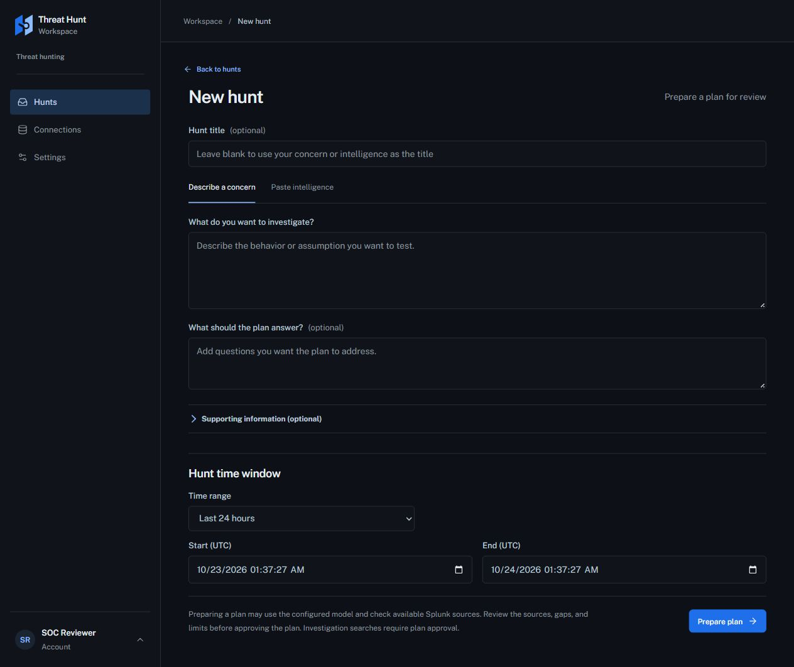
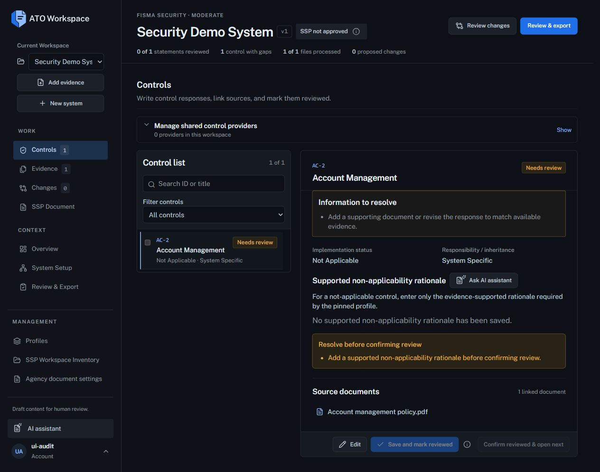

# Three-app UI alignment verification — v1.6.0

## Result

The approved placeholder-color and ordinary-label role changes are implemented
across Threat Hunting, ATO and all four Incident Response frontend variants.
This is evidence for the shared roles and sampled workflows, not a claim that
every page, customer theme, exported document or production identity path is identical.

- Form values use 14px/400; ordinary labels use 13px/500 in #BBC6D3.
- Placeholder text uses #8B949E at opacity 1, including custom combobox hints.
- Compact action text stays 12px; action-style labels and semantic labels retain their roles.
- New Hunt keeps the Hunts destination selected using the existing parsed route.
- Common page, raised, heading, body, muted, border, action and link colors use
  the same shared tokens. Semantic status colors and contextual surfaces remain intentional.
- Existing grids, widths, control dimensions, navigation, draft/review guards,
  authentication/identity handling and export contracts are preserved.
- The six builds and focused unit tests passed locally. No GitHub Actions were requested. The browser records below cover
  all six frontends in Chromium, Firefox and WebKit, including exact form roles,
  colors, placeholder contrast/opacity, label emphasis, selection, keyboard account controls and enlarged text.

## Visual evidence

See [the measured styles](evidence/computed-styles.json),
[build results](evidence/text-role-build-results.json) and
[browser results](evidence/text-role-browser-results.json).
The log files in `evidence/text-role-check-*.log` and `evidence/text-role-build-*.log`
record the executed checks. Earlier v1.4 logs are retained as historical evidence.

## Scope and decisions

The follow-up comparison found browser-default placeholder gray and inconsistent label emphasis. The baseline now assigns
explicit color/weight roles instead of relying on browser defaults or app-local choices. This follows the
Fluent 14px body scale while preserving compact enterprise controls; WCAG does
not prescribe a minimum CSS pixel size. Text enlargement is checked separately.

The apps intentionally retain different workflows and content layouts: ATO's
system/work/review groups, Hunt planning, and Incident Response conversation/case
context. Code/identifier editors, native non-text controls, metadata, semantic
warning/error/success headings and contextual surfaces retain documented exceptions.

Visual previews and browser tests use synthetic API/identity fixtures. They do
not qualify live cloud/Entra deployments, execute investigations or approve SSPs.
No production workflows, permissions, backend APIs or live records were changed.

The ATO creation-page title remains a separate known mapping issue from the follow-up audit; this release does not change that page layout.

Exact source commits and source/local checksums are in [manifest.json](manifest.json).
